# Route 40 Motors — Service Booking & Aftersales Platform

An automotive aftersales application built on **SAP BTP ABAP Environment** with the **ABAP RESTful Application Programming Model (RAP)**, **CDS** and **SAP Fiori Elements**, plus an **AI booking summary** prototype.

Route 40 Motors models a multi-site car workshop. A customer's vehicle is booked for service, each booking reserves a spare part at a specific site, and the back end refuses the booking if that part is not in stock at that site. When a service is completed, the app creates an invoice with a ZATCA-style QR code (TLV, Base64). The project also tracks parts deliveries and includes a Saudization (Nitaqat-style) workforce report, reflecting the Saudi market it is themed on.

> Sample data in this repository is fictional.

**Demo video (2 min):** [Watch on YouTube](https://youtu.be/Lkluje2rYjA)

**Author:** Sharfunisa Shajahan · [GitHub](https://github.com/Nishaweb-developer) · [Portfolio](https://nishaweb-developer.github.io/myworks)

---

## What it does

- **Service bookings**: list report and object page with create, edit and delete.
- **Stock validation**: a server-side validation (`checkStock`) blocks a booking when the part does not exist at the chosen site or is out of stock, on both create and edit.
- **Input normalisation**: part, site and technician IDs are converted to upper case before validation, so `p001` and `P001` behave the same.
- **Complete Service action**: completes a booking and creates an invoice record in `ZINVOICE` (net amount, 15% VAT, total in SAR). A completed booking cannot be completed again.
- **Invoice QR code**: a ZATCA-style QR (TLV, Base64) is generated by `ZCL_ZATCA_TLV` and drawn on the booking object page.
- **Master data**: vehicles, sites, spare parts (stock is kept per part and per site), technicians.
- **Deliveries**: purchase-order quantity, delivered quantity and open quantity per delivery, with a *Receive Remaining* action.
- **Saudization report**: share of Saudi technicians per department, with a colour band.
- **AI booking summary** (prototype): a Python script that summarizes bookings and drafts customer reminders, with automated output checks. The in-app ABAP button is built but blocked on the trial. See [AI booking summary](#ai-booking-summary).

## Architecture

Every entity follows the same RAP layering:

```
Database table              ZSVCBOOKING, ZSPAREPART, ZVEHICLE, ZSITE, ZTECHNICIAN, ZDELIVERY, ZINVOICE
      |
Interface view  ZI_*        + behavior definition + behavior pool ZBP_I_* (validations, actions)
      |
Projection view ZC_*        + metadata extension ZME_* (Fiori list and object page layout)
      |
Service definition          ZSD_SVCBOOKING
      |
Service binding             ZSB_SVCBOOKING_V2  (OData V2 - UI)
      |
Fiori Elements app          List Report + Object Page (+ custom InvoiceQR section)
```

Supporting classes:

| Class | Purpose |
| --- | --- |
| `ZCL_ZATCA_TLV` | Builds the TLV byte structure and Base64 string for the invoice QR, with an ABAP Unit test class that checks the output against a reference value |
| `ZCL_SEED_*` | Loads fictional sample data |

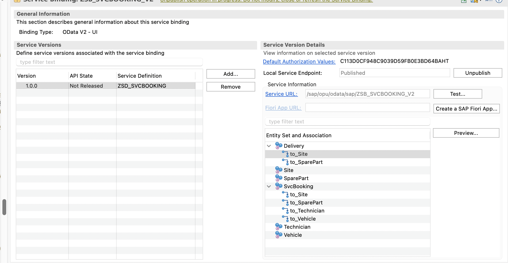

## Data model

| Table | Purpose | Linked to |
| --- | --- | --- |
| `ZSVCBOOKING` | One service job: vehicle, part, site, technician, dates, status, AI summary text | Vehicle, SparePart, Site, Technician |
| `ZVEHICLE` | Customer vehicles | Booking |
| `ZSPAREPART` | Stock per part **and** site (key `PART_ID` + `SITE_ID`), price, currency | Booking, Delivery |
| `ZSITE` | Workshop locations | Booking, Delivery, SparePart |
| `ZTECHNICIAN` | Technicians: name, nationality, department, join date | Booking, Saudization report |
| `ZDELIVERY` | Incoming parts against a PO | SparePart, Site |
| `ZINVOICE` | Invoice per completed service: number, amounts, VAT, QR text | Booking |

## Stock validation (`checkStock`)

The validation runs on save. It looks up the part at the booking's site in `ZSPAREPART` and reports an error on the booking if the row is missing or the quantity is zero.

```abap
" Simplified from the behavior pool ZBP_I_SVCBOOKING
SELECT SINGLE qty_stock FROM zsparepart
  WHERE part_id = @booking-PartId
    AND site_id = @booking-SiteId
  INTO @DATA(qty).

IF sy-subrc <> 0.
  " failed + reported: "Part '<id>' not found for site '<site>'"
ELSEIF qty = 0.
  " failed + reported: "Part is out of stock"
ENDIF.
```

### Test results

| Scenario | Result | Evidence |
| --- | --- | --- |
| Part with stock at the site (P001 / S001) | Saves, row written to `ZSVCBOOKING` | [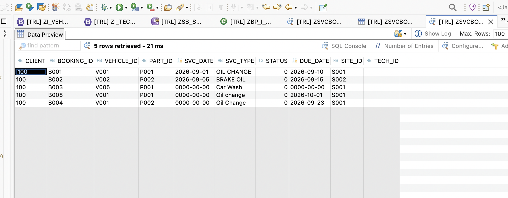](https://github.com/Nishaweb-developer/ABAP_Route40_Motors/blob/main/screenshots/09-booking-saved-db.png) |
| Part with zero stock at the site (P002 / S002) | Blocked: *Part is out of stock* | [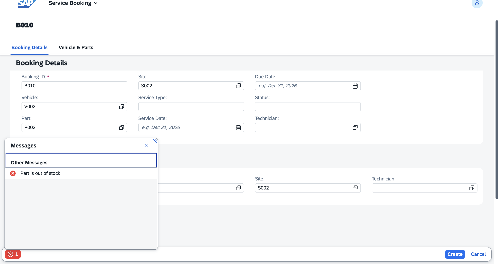](https://github.com/Nishaweb-developer/ABAP_Route40_Motors/blob/main/screenshots/03-out-of-stock-create.png) |
| Unknown part (P999 / S001) | Blocked: *Part 'P999' not found for site 'S001'* | [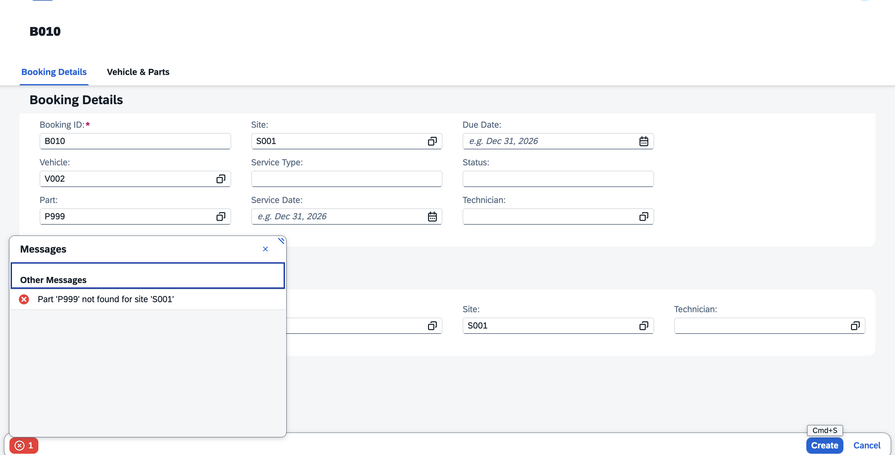](https://github.com/Nishaweb-developer/ABAP_Route40_Motors/blob/main/screenshots/04-part-not-found.png) |
| Unknown site (P001 / S999) | Blocked: *Part 'P001' not found for site 'S999'* | [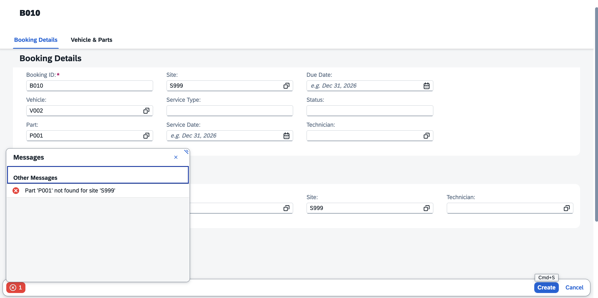](https://github.com/Nishaweb-developer/ABAP_Route40_Motors/blob/main/screenshots/05-site-not-found.png) |
| Empty part | Blocked: *Part '' not found for site 'S999'* | [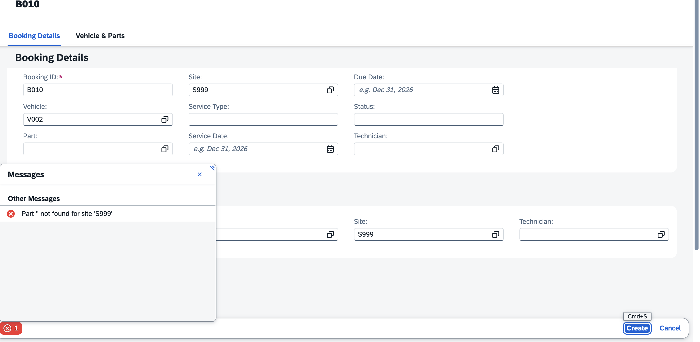](https://github.com/Nishaweb-developer/ABAP_Route40_Motors/blob/main/screenshots/06-empty-part.png) |
| Edit an existing booking and move it to a site with no stock | Blocked on save: *Part is out of stock* | [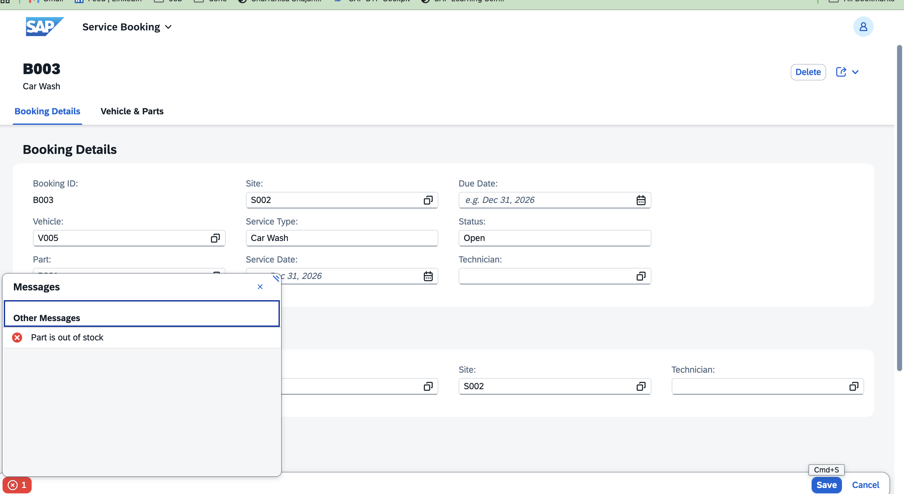](https://github.com/Nishaweb-developer/ABAP_Route40_Motors/blob/main/screenshots/08-out-of-stock-on-edit.png) |
| Lowercase input (`p001`) | Normalised to `P001` and validated normally | [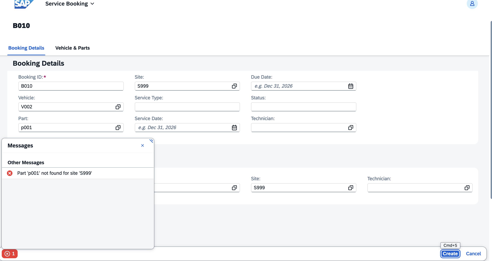](https://github.com/Nishaweb-developer/ABAP_Route40_Motors/blob/main/screenshots/07-case-sensitive.png) |

### Booking object page

[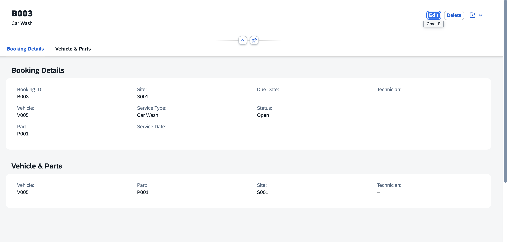](https://github.com/Nishaweb-developer/ABAP_Route40_Motors/blob/main/screenshots/02-booking-object-page.png)

## Complete Service and invoice QR

The *Complete Service* action finishes a booking and writes an invoice to `ZINVOICE`. For example, a net amount of 22,000.00 SAR plus 15% VAT of 3,300.00 SAR gives a total of 25,300.00 SAR (invoice `INV-B015`).

The QR text is built by `ZCL_ZATCA_TLV` as a TLV structure (tag, length, value) and then Base64-encoded. The tags hold seller name, VAT registration number, timestamp, invoice total and VAT amount. The booking object page then draws the QR picture in a custom section (`InvoiceQR`) built with QRCode.js in an SAP Business Application Studio Fiori project.

[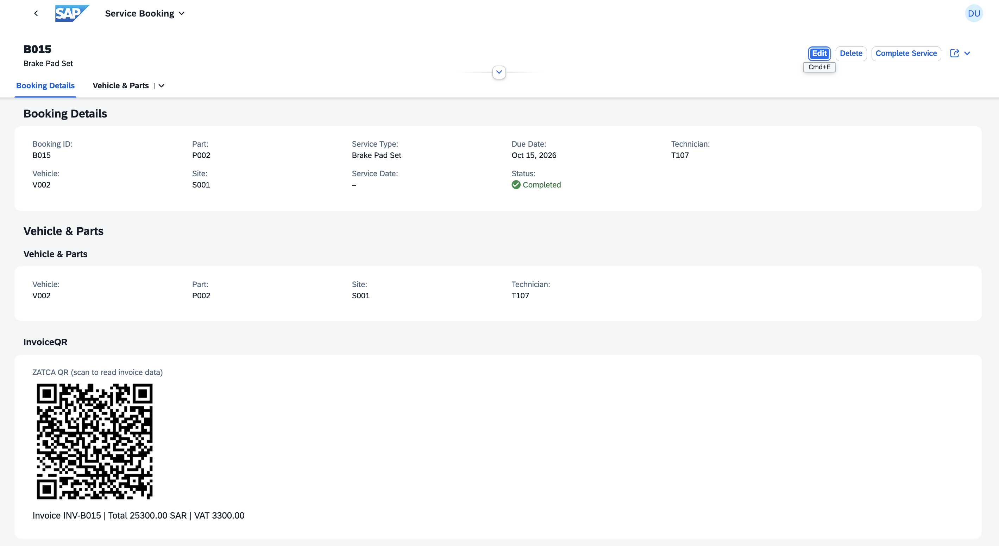](https://github.com/Nishaweb-developer/ABAP_Route40_Motors/blob/main/screenshots/18-qr-object-page.png)

**Complete Service in action**

| What happens | Evidence |
| --- | --- |
| Booking B008 completed (status 0 to 3) | [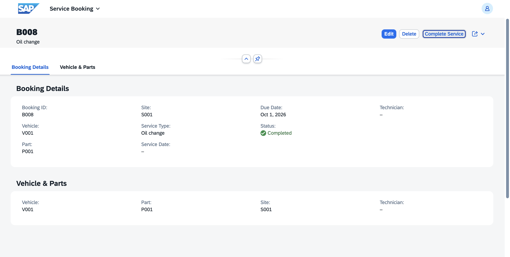](https://github.com/Nishaweb-developer/ABAP_Route40_Motors/blob/main/screenshots/13-complete-service-success.png) |
| Stock of the part drops by one | [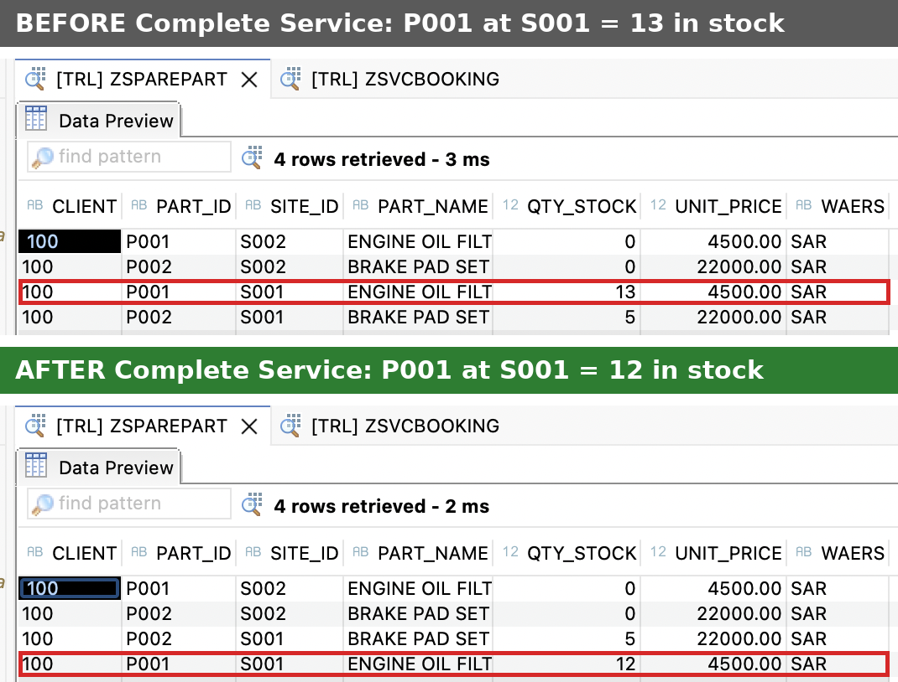](https://github.com/Nishaweb-developer/ABAP_Route40_Motors/blob/main/screenshots/15-stock-before-after.png) |
| Status changes in the database | [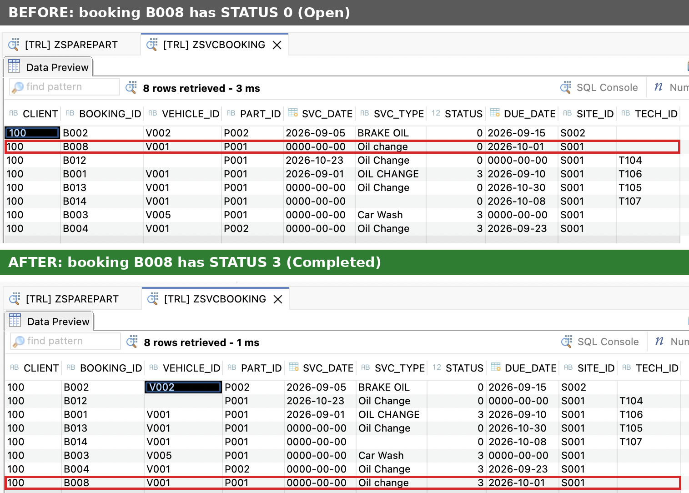](https://github.com/Nishaweb-developer/ABAP_Route40_Motors/blob/main/screenshots/23-booking-status-before-after.png) |
| Invoice row with the QR text in `ZINVOICE` | [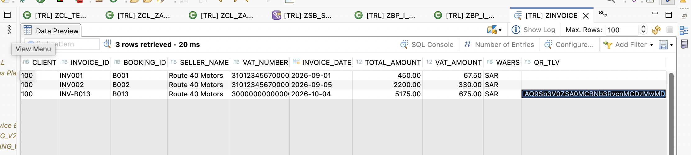](https://github.com/Nishaweb-developer/ABAP_Route40_Motors/blob/main/screenshots/16-invoice-table.png) |

A booking can only be completed once. Trying again shows *Booking is already completed* and no second invoice is created.

[](https://github.com/Nishaweb-developer/ABAP_Route40_Motors/blob/main/screenshots/12-already-completed-guard.png)

[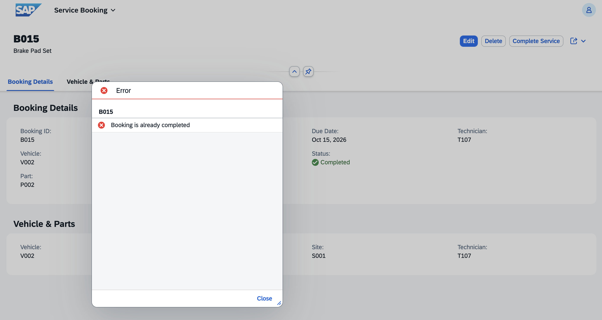](https://github.com/Nishaweb-developer/ABAP_Route40_Motors/blob/main/screenshots/14-complete-service-already-completed.png)

**Scope:** this is a ZATCA-style QR for demonstration. It shows how the TLV format works and how to render it in Fiori. It does not submit invoices to any tax authority, and the seller and VAT numbers in the sample data are fictional.

## Deliveries

Each delivery shows the PO quantity, delivered quantity and open quantity, and offers a *Receive Remaining* action.

[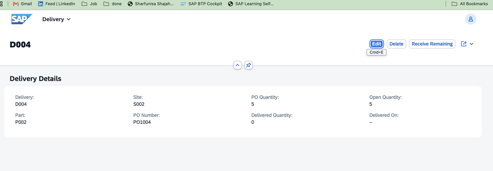](https://github.com/Nishaweb-developer/ABAP_Route40_Motors/blob/main/screenshots/10-delivery-object-page.png)

## Saudization report

Saudization is Saudi Arabia's policy of raising the share of Saudi nationals in private-sector employment, and **Nitaqat** is the program that measures it and assigns companies a colour band. This report calculates, per department:

```
Saudization % = Saudi technicians / total technicians x 100
```

It is built as three stacked CDS view entities (counts, percentage, band), projected as `ZC_SaudiBand`, exposed as the `SaudiBand` entity, and shown in a Fiori Elements list report with criticality colours.

[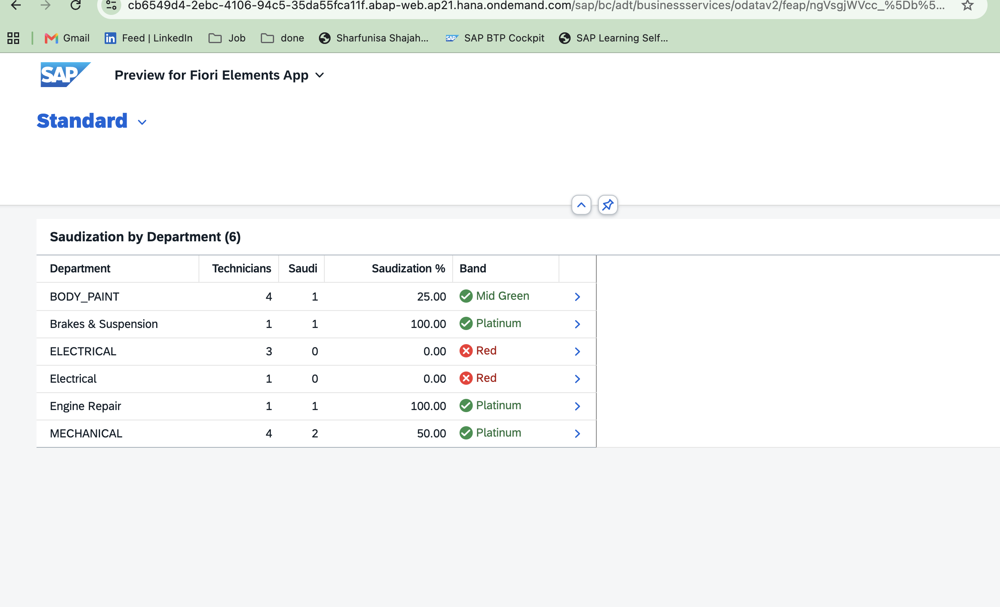](https://github.com/Nishaweb-developer/ABAP_Route40_Motors/blob/main/screenshots/11-saudization-report.png)

**Important:** the bands (Red, Low Green, Mid Green, High Green, Platinum) use **illustrative cut-offs** (below 10, 20, 30 and 40 percent, then Platinum), not official Nitaqat thresholds. Real Nitaqat is calculated for a whole establishment, by sector and company size, not per department. The per-department view is a simplification for this demo.

## AI booking summary

This part of the project uses an LLM to summarize service bookings and draft customer reminders. It is an early experiment, built next to the core app. It is split into two parts:

| Part | Status |
| --- | --- |
| **Python prototype** (`route40-ai-assistant/`) | Working. Runs on exported SAP data, with automated output checks. |
| **ABAP version** (*Generate AI Summary* action in the Fiori app) | Built, but blocked. The app loads and shows the button, but the call to Gemini cannot run from the trial ABAP environment. |

### What the Python prototype does

1. Loads service bookings from `bookings.json` (exported from the Route 40 service).
2. For each booking, sends the record to Google Gemini with rules: use only the facts provided, write "not provided" for missing fields, never name a technician without a value, flag service/part mismatches, and write a customer reminder only for open bookings.
3. Retries automatically when Gemini is busy (`503`), waiting longer each time.
4. Runs checks on each answer and prints PASS or FAIL.

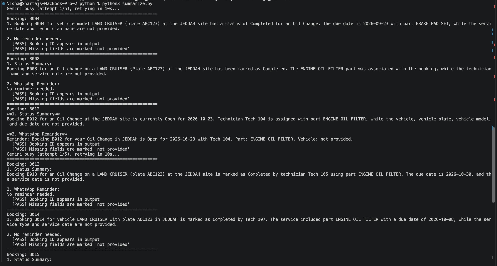

*First run of `summarize.py`: a status summary, a reminder when needed, and PASS/FAIL checks for each booking.*

### The ABAP side

The booking has an `AI_SUMMARY` field, and the `generateAiSummary` action (with instance feature control) is meant to fill it.

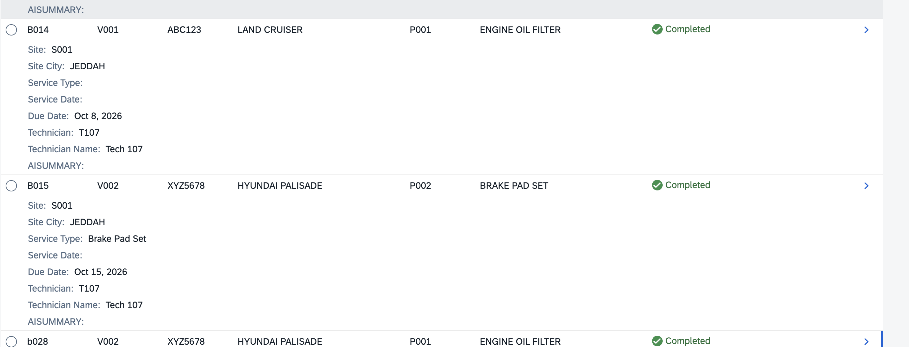

*The booking list loads. The AI summary field is empty because the action has not run successfully yet.*

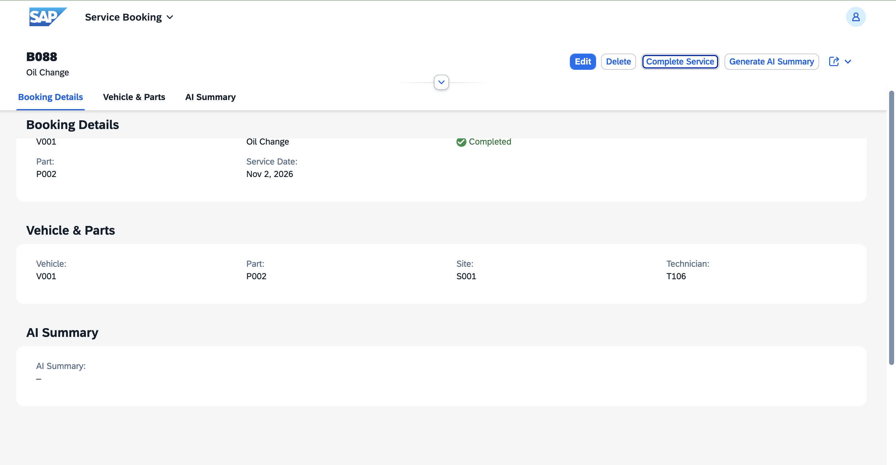

*The object page shows Generate AI Summary next to Complete Service.*

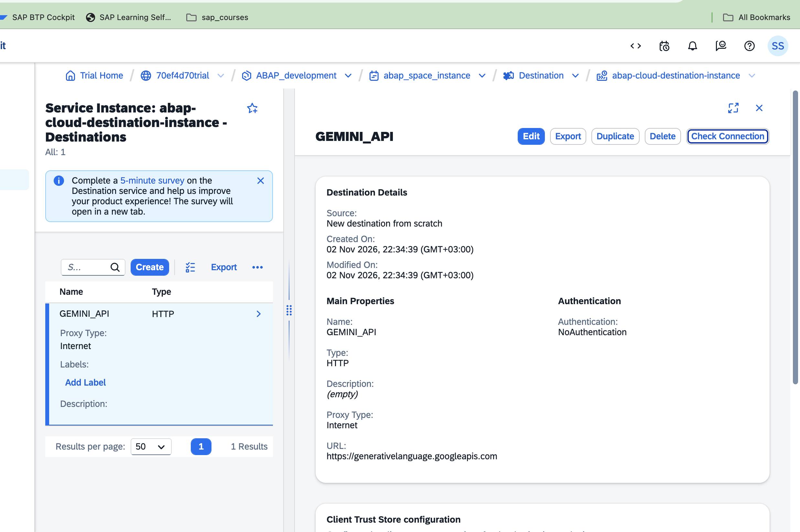

*The HTTP destination `GEMINI_API` in the destination service instance used by the ABAP environment.*

### What the AI checks found

- **Repeated data mismatch.** Booking B004 is an oil change with a brake pad set. The AI repeated both facts without flagging the mismatch. The second version of the prompt requires flagging it.
- **Lowercase booking ID.** `b028` was not flagged. The check failed, and the prompt now requires flagging it.
- **Internal labels in a customer reminder.** Booking B012's reminder included "Status: Open" and "Vehicle details: not provided", which should not reach a customer. The prompt now forbids this.

### Why the ABAP version is blocked

The ABAP class `ZCL_AI_SUMMARY` calls Gemini through the destination `GEMINI_API`. The call fails before it starts, because ABAP cannot find the destination. The steps tried, and where each one stopped:

| Step | Result |
| --- | --- |
| Fiori app loads after adding `get_instance_features` | Fixed a `RAISE_SHORTDUMP` |
| Button visible after `FOR_ACTION` annotation | Fixed |
| Destination created in the destination service instance | Created |
| Console test `ZCL_TEST_DEST` | `Destination not found` |
| Debugger | `CX_HTTP_DEST_PROVIDER_ERROR` caused by `CX_A4C_DESTINATION_NOT_FOUND` |
| Destination service instance binding | `Bound Applications (0)`; no binding is possible from this screen |
| Communication arrangement SAP_COM_0276 | App not visible to the trial user; needs the ABAP business role |

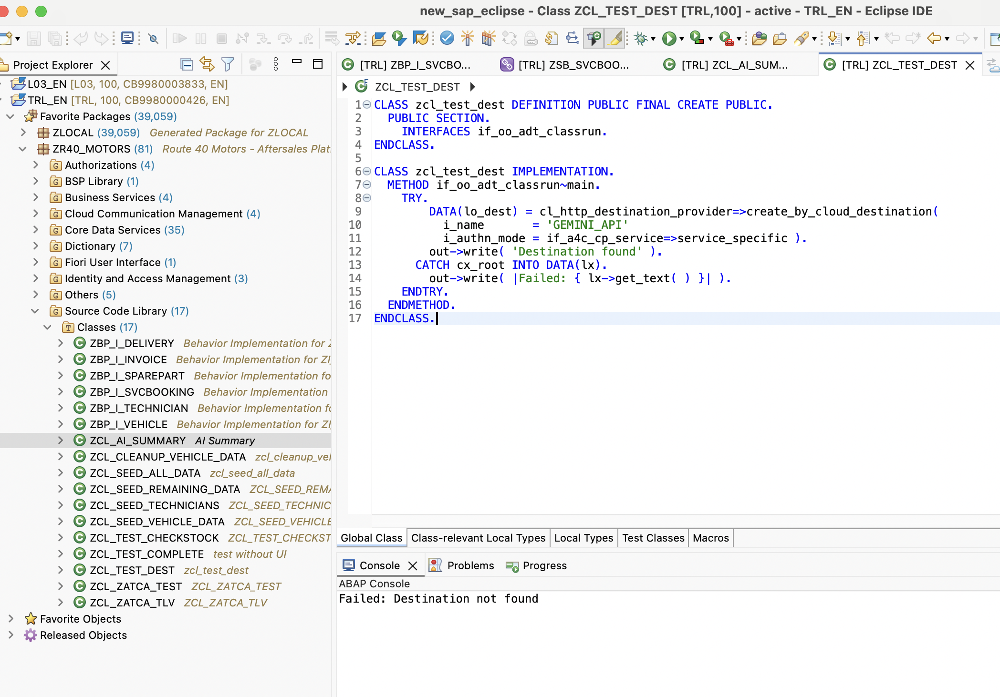

*The console test returns `Destination not found`, although `GEMINI_API` exists in the destination service instance.*

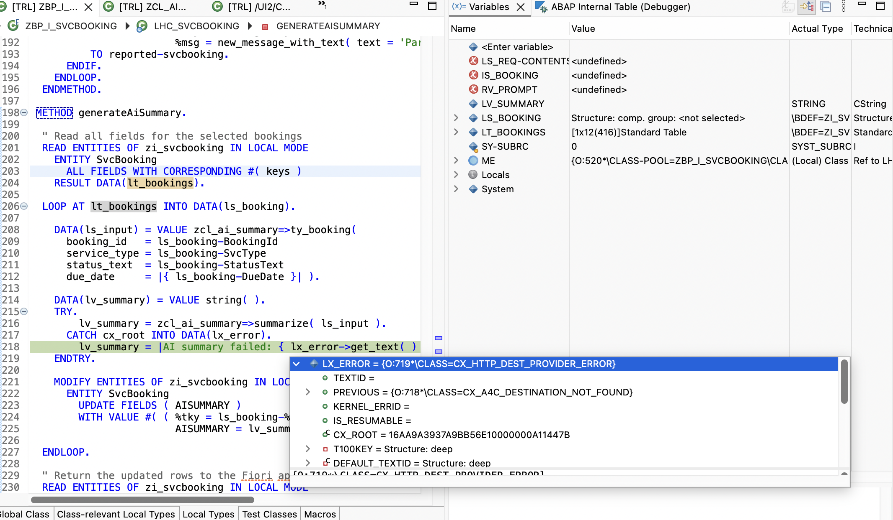

*In the debugger, the error is `CX_HTTP_DEST_PROVIDER_ERROR` caused by `CX_A4C_DESTINATION_NOT_FOUND`. The Gemini call never starts.*

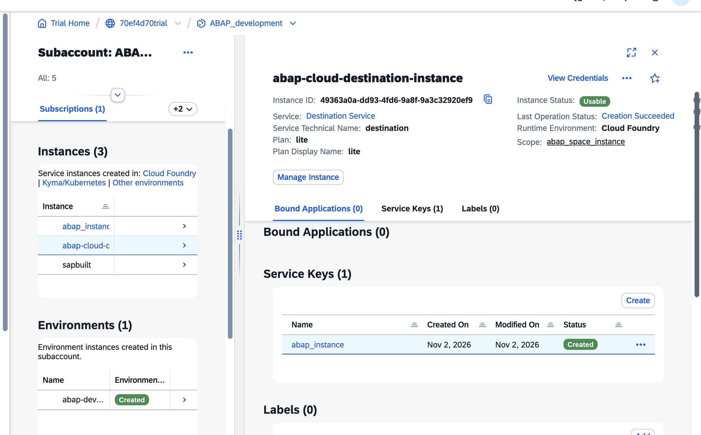

*The destination service instance shows `Bound Applications (0)`.*

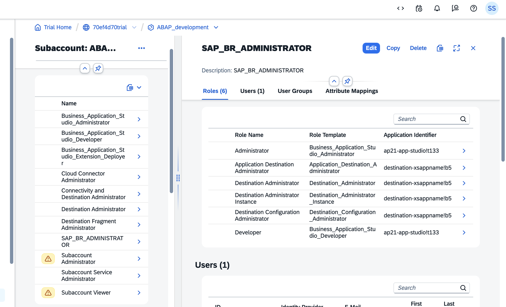

*The BTP role collection contains cockpit, destination, and Business Application Studio roles. It does not contain the ABAP business catalog that exposes the Communication Arrangements app. That role has to be assigned inside the ABAP system, which the trial user cannot reach.*

SAP's documentation says the destination-service route is not usable on trial systems, so the ABAP call may not be possible on this account. The Python prototype is the working AI layer until that changes.

Full build history, including every error and fix, is in [`route40-ai-assistant/README.md`](route40-ai-assistant/README.md).

## Tech stack

- SAP BTP ABAP Environment (ABAP Cloud)
- RAP managed scenario: behavior definitions, validations, actions, `strict ( 2 )`
- CDS view entities, projection views, metadata extensions
- OData V2 service definition and binding (UI)
- SAP Fiori Elements (list report and object page) with a custom section
- ABAP Unit (TLV class)
- TLV and Base64 with the XCO library (`xco_cp`) and `cl_web_http_utility`
- QRCode.js (custom Fiori section)
- Python 3.12 and the Google Gemini API (AI prototype)
- ABAP Development Tools (Eclipse), SAP Business Application Studio, abapGit

## Run it yourself

**SAP side**

1. Install the abapGit plugin in ADT and link this repository to a package in your ABAP Environment system, then **Pull**.
2. Activate all objects.
3. Run the seed classes (`ZCL_SEED_*`) with `F9` to load sample vehicles, sites, parts, bookings and technicians.
4. Open the service binding `ZSB_SVCBOOKING_V2`, publish it, select an entity (for example `SvcBooking`) and click **Preview**.

**AI prototype (Python)**

```bash
pip3 install google-genai
export GEMINI_API_KEY="your-key-here"   # never commit this
cd route40-ai-assistant
python3 summarize.py
```

## Known limitations

- Stock is reduced by one when a service is completed, but there is no locking yet, so two users could take the last part at the same time.
- No authorization checks or draft handling yet.
- Saudization bands are illustrative (see above).
- The invoice QR is for demonstration only (see scope note above).
- **AI:** the Python prototype reads an exported file, not a live OData call. The ABAP AI button cannot reach Gemini on this trial (see [The ABAP side](#the-abap-side)).
- **AI:** the checks are pattern-based. A PASS means the basic rules held, not that the answer is correct.
- **AI:** Gemini's free tier has rate and daily limits, and returns `503` when busy.

## Roadmap

The order is deliberate: finish and test the core application first, then integration, then the experimental features. A solid, explainable project comes before a flashy one.

**Phase 1 — Core quality (in progress)**

- [x] Stock validation (`checkStock`) on create and edit
- [x] Upper-case input normalisation
- [x] Complete Service action with invoice and TLV QR
- [x] ABAP Unit test for the TLV class
- [x] Stock deduction when a service is completed
- [ ] Locking so two users cannot take the last part
- [ ] Authorization (access control) and draft handling
- [ ] ABAP Unit tests for `checkStock` and Complete Service
- [ ] Technician assignment warning when a hire would lower a department's Saudization ratio

**Phase 2 — Integration**

- [ ] Booking-completed business event picked up by an SAP Cloud Integration flow that sends a "your car is ready" email
- [ ] Classic ALV companion report on an on-premise system
- [ ] Cloud Connector, RFC and IDoc scenario

**Phase 3 — Experimental (only after Phases 1 and 2)**

- [x] **AI booking summary, first prototype:** Python version working with output checks; the ABAP version is blocked on the trial (see above)
- [ ] **AI service advisor:** the customer describes the problem, the model suggests a summary, urgency and part, and `checkStock` validates the suggestion. The model can only choose from the real parts catalog, and a human confirms before the booking is saved. No customer names or phone numbers are sent in prompts, and each request and response is logged.
- [ ] **WhatsApp notification:** the "your car is ready" message is also sent over WhatsApp through the integration flow, using a sandbox account and no real customer data.
- [ ] **MCP server:** expose the booking service to an AI assistant so a user can ask it to book a service. Exploratory, and depends on current SAP support.

## About

ABAP_Route40_Motors — Sharfunisa Shajahan
